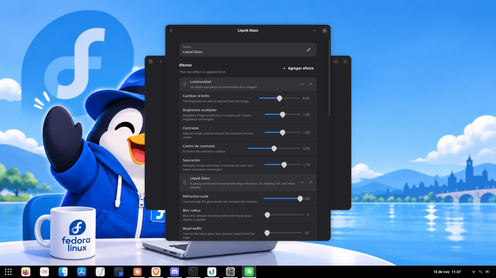
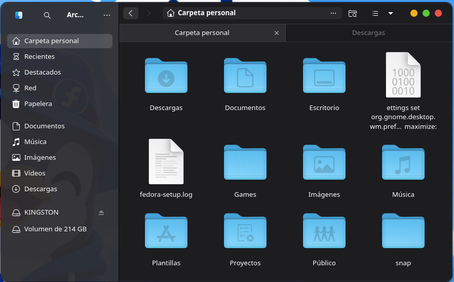
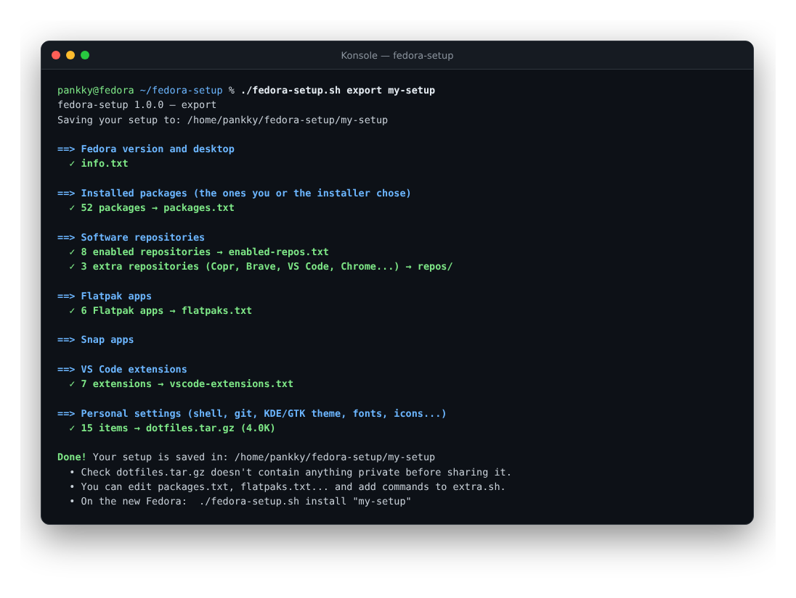
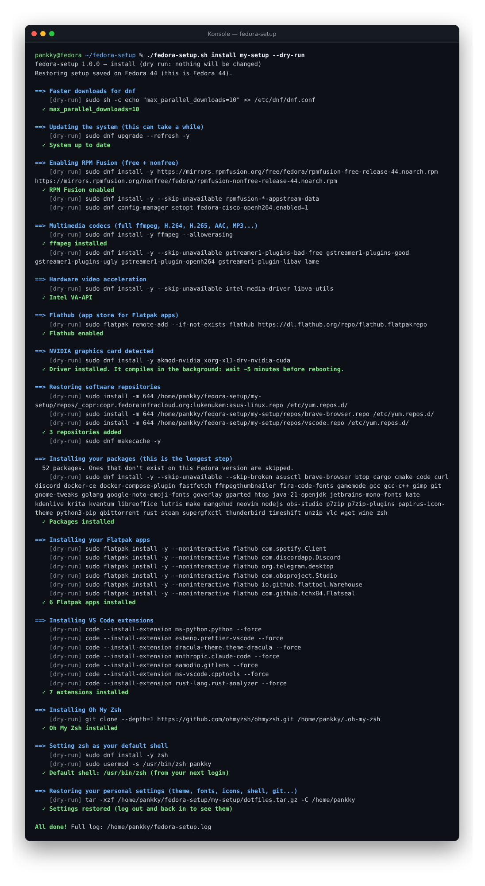

# Fedora Setup in One Command ⚡

Save how your Fedora is set up, and get it back on a fresh install with **one command**:
your apps, repositories, Flatpaks, Snaps, VS Code extensions, shell, GNOME or KDE theme, extensions, fonts and icons.

It also installs what every fresh Fedora needs: RPM Fusion, multimedia codecs, Flathub, and
NVIDIA / ASUS tools when it detects that hardware.

Made by **PANKKY**.

<p align="center">
  
  <br><sub>My Fedora (GNOME, macOS-style theme and dock). This is what <code>install</code> brings back.</sub>
</p>

<p align="center">
  
  &nbsp;
  
</p>

<p align="center">
  
</p>

## Quick start

### On your current Fedora: save your setup

```bash
git clone https://github.com/P4NKK-TRYHARD/Fedora-Setup-in-One-Command.git
cd Fedora-Setup-in-One-Command
./fedora-setup.sh export my-setup
```

This creates a `my-setup/` folder. Copy it to a USB stick, the cloud, or a **private** repository.

### On the new Fedora: restore everything

Put `my-setup/` next to the script, then run:

```bash
./fedora-setup.sh install my-setup
```

Reboot when it finishes. That's it.

<details>
<summary>📸 See what <code>install</code> does (dry run)</summary>
<p align="center">
  
</p>
</details>

### No saved setup? Just the essentials

```bash
./fedora-setup.sh essentials
```

## What it does

| Step | `essentials` | `install` |
|---|:-:|:-:|
| Faster dnf downloads and a full system update | ✅ | ✅ |
| RPM Fusion (free + nonfree) and its app store data | ✅ | ✅ |
| Full multimedia codecs (ffmpeg, H.264/H.265, AAC, MP3) | ✅ | ✅ |
| Hardware video acceleration (Intel / AMD) | ✅ | ✅ |
| Flathub | ✅ | ✅ |
| NVIDIA driver *(asks first, warns about Secure Boot)* | ✅ | ✅ |
| ASUS tools: asusctl, fan profiles, battery limit *(asks first)* | ✅ | ✅ |
| Your extra repositories (Copr, Brave, VS Code, Chrome…) | | ✅ |
| Your packages | | ✅ |
| Your Flatpak and Snap apps | | ✅ |
| Your VS Code extensions | | ✅ |
| Your shell (zsh + Oh My Zsh) | | ✅ |
| Your settings: GTK/KDE theme, icons, fonts, terminal, git… | | ✅ |
| Your GNOME desktop: dock, extensions, shortcuts, wallpaper (dconf) | | ✅ |
| Your own commands from `extra.sh` | | ✅ |

## What's inside `my-setup/`

| File | Content |
|---|---|
| `packages.txt` | Packages to install (one per line, edit freely) |
| `enabled-repos.txt`, `repos/` | Your extra repositories |
| `flatpaks.txt`, `snaps.txt` | Your apps |
| `vscode-extensions.txt` | Your VS Code extensions |
| `dotfiles.tar.gz` | Your settings (theme, fonts, icons, shell, git…) |
| `dconf.ini`, `gnome-extensions.txt` | Your GNOME settings and enabled extensions |
| `extra.sh` | Your own commands, run at the end |

It **never** saves passwords or keys (`.ssh`, `.gnupg`, browser profiles…). Even so, check
`dotfiles.tar.gz` before sharing it (your `.zshrc` or `.gitconfig` could contain tokens or
your email).

## Options

```
-n, --dry-run   Show what would be done, without changing anything
-y, --yes       Don't ask questions (answer "yes" to optional steps)
-h, --help      Help
```

Try it safely first:

```bash
./fedora-setup.sh install my-setup --dry-run
```

## Good to know

- Run it as your normal user, **not** with `sudo`. It asks for your password when needed.
- Packages that don't exist on the new Fedora version are skipped, not fatal.
- Files it would overwrite in your home folder are backed up to `~/fedora-setup-backup-<date>/`.
- Everything is logged to `~/fedora-setup.log`. Failed steps are listed at the end.
- Works on Fedora Workstation and spins (KDE, etc.). Atomic editions (Silverblue, Kinoite) are not supported.
- After installing the NVIDIA driver, wait ~5 minutes before rebooting so it can finish building.

## License

MIT © 2026 **PANKKY**. You're free to use, modify and share it, as long as you keep the copyright notice and credit the author.
